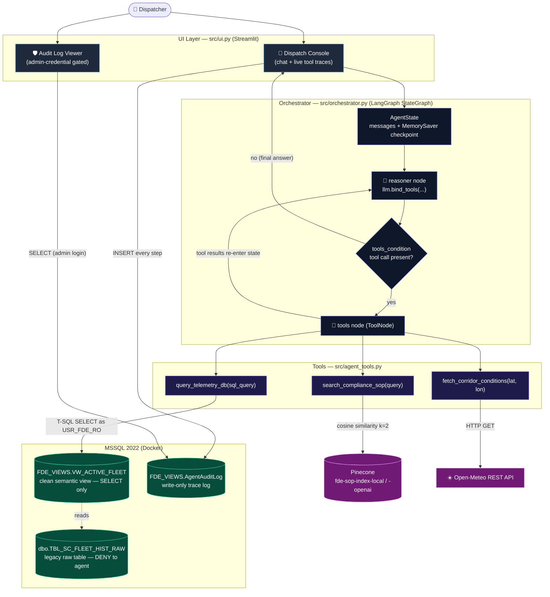
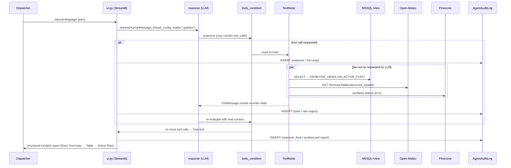
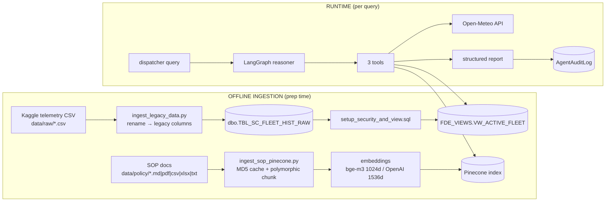
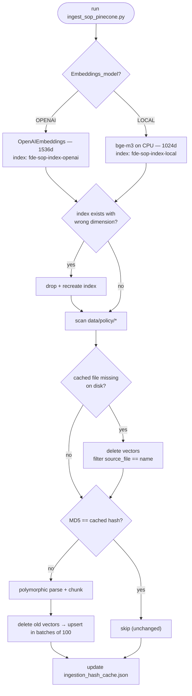
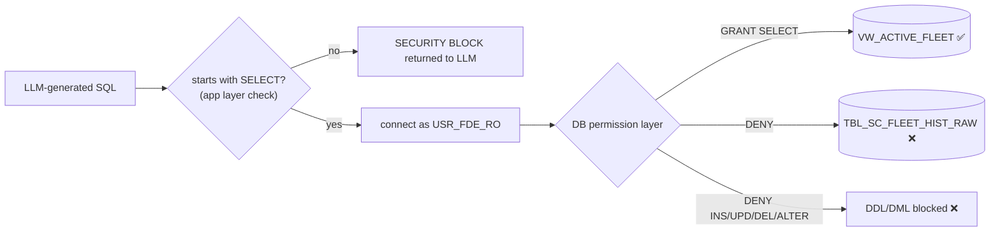
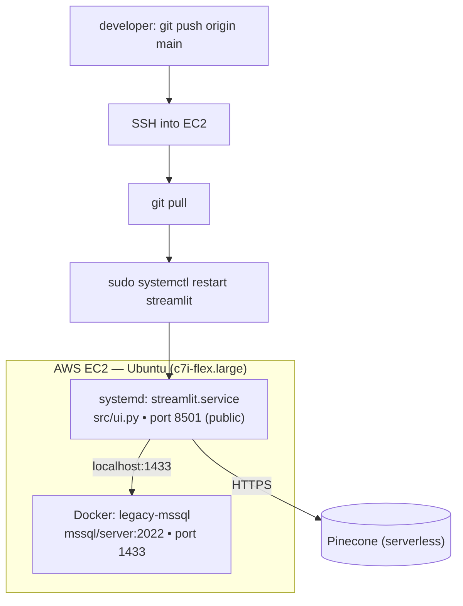

# 🏗️ Architecture — Cold-Chain Logistics FDE Operational Control Platform

> System design and flow reference, verified directly against the source code in
> [`src/`](src/), [`scripts/`](scripts/), and [`data/`](data/).
> For business framing and interview prep, see [`PROJECT_DEEP_DIVE.md`](PROJECT_DEEP_DIVE.md).
> For deployment steps, see [`docs/instrutions.md`](docs/instrutions.md).

---

## 1. What the system is

An AI-driven operational console that lets non-technical cold-chain dispatchers ask
natural-language questions ("is this shipment breaching its temperature SOP?") and get
back an actionable incident report. A **LangGraph** state-machine agent autonomously
decides which of three tools to call — SQL telemetry, live weather, and a vector-indexed
SOP search — loops until it has enough context, then synthesizes a structured answer.

The design is driven by a **Forward Deployed Engineering** posture: wrap legacy
infrastructure safely, enforce least privilege at the database, and support both cloud and
air-gapped runtimes.

---

## 2. Component map

| Layer | Implementation | Role |
| :--- | :--- | :--- |
| **UI** | Streamlit — [`src/ui.py`](src/ui.py) | Dispatch Console (chat + live tool traces) and an admin-gated Audit Log viewer |
| **Orchestrator** | LangGraph `StateGraph` — [`src/orchestrator.py`](src/orchestrator.py) | Cyclic `reasoner ↔ tools` loop; LLM factory (OpenAI / DeepSeek / Ollama) |
| **Tools** | [`src/agent_tools.py`](src/agent_tools.py) | `query_telemetry_db`, `fetch_corridor_conditions`, `search_compliance_sop` |
| **System prompt** | [`src/prompts/system_prompt.txt`](src/prompts/system_prompt.txt) | Operational flow rules + mandated report format |
| **Relational DB** | MSSQL 2022 (Docker) | Legacy raw table + clean semantic view + write-only audit log |
| **Semantic/security layer** | [`scripts/setup_security_and_view.sql`](scripts/setup_security_and_view.sql) | `FDE_VIEWS.VW_ACTIVE_FLEET` view + `USR_FDE_RO` least-privilege login |
| **Vector DB** | Pinecone (`langchain-pinecone`) | Chunked SOP documents for semantic retrieval (k=2, cosine) |
| **Embeddings** | `BAAI/bge-m3` (local, 1024d) or OpenAI (1536d) | Switchable via `Embeddings_model` env var |
| **External API** | Open-Meteo REST | Live corridor weather by GPS; wind drives a congestion index |
| **Ingestion** | [`scripts/ingest_legacy_data.py`](scripts/ingest_legacy_data.py), [`scripts/ingest_sop_pinecone.py`](scripts/ingest_sop_pinecone.py) | Offline CSV→MSSQL and SOP→Pinecone pipelines |

---

## 3. System architecture



### The LangGraph loop (exact wiring)

From [`src/orchestrator.py`](src/orchestrator.py):

```
START ──► reasoner ──(tools_condition)──► tools ──► reasoner ──► ... ──► END
                         │
                         └── no tool call ──► END (final text answer)
```

- `reasoner` node calls `llm_with_tools.invoke(state["messages"])`.
- `tools_condition` (prebuilt) inspects the last message: if it carries `tool_calls`,
  route to `tools`; otherwise end and return the text.
- `tools` (prebuilt `ToolNode`) executes the requested tool(s) and appends `ToolMessage`
  results back into state, which re-enters `reasoner`. This cycle is what lets the agent
  chain SQL → weather → SOP within one user turn.
- State is `AgentState = {messages: add_messages}`, persisted per thread via
  `MemorySaver()` keyed on `thread_id`.

---

## 4. Runtime request flow



The report format is enforced by [`system_prompt.txt`](src/prompts/system_prompt.txt):
**(1)** Executive Summary, **(2)** Telemetry & Environment Analysis table, **(3)** Required
Action Plan with an explicit SOP citation. The prompt also mandates tool order:
telemetry first, then corridor conditions, then SOP lookup.

---

## 5. Data flow — two distinct paths



### Schema translation (raw → legacy → semantic)

The CSV is loaded, renamed into deliberately cryptic "legacy" columns, then exposed through
a clean view so the LLM never sees obfuscated names.

| CSV column | Legacy column (`TBL_SC_FLEET_HIST_RAW`) | View column (`VW_ACTIVE_FLEET`) |
| :--- | :--- | :--- |
| `timestamp` | `TS_UTC` | `Timestamp` |
| `vehicle_gps_latitude` | `V_LAT` | `Latitude` |
| `vehicle_gps_longitude` | `V_LON` | `Longitude` |
| `iot_temperature` | `IOT_TEMP_VAL_C` | `Current_Temperature_C` (CAST FLOAT) |
| `cargo_condition_status` | `CGO_COND_CD` | `Cargo_Condition_Code` |
| `risk_classification` | `RISK_CLS_TXT` | `Risk_Classification` |
| `delay_probability` | `DELAY_PROB_DEC` | `Delay_Probability` |
| `port_congestion_level` | `PRT_CNG_LVL` | `Port_Congestion_Level` |
| `route_risk_level` | `RT_RSK_IDX` | `Route_Risk_Index` |

---

## 6. SOP ingestion pipeline (RAG)

[`scripts/ingest_sop_pinecone.py`](scripts/ingest_sop_pinecone.py) is incremental and
self-healing:



Polymorphic parsing by file type:

- **`.md`** — header split (`#`/`##`/`###`) then `RecursiveCharacterTextSplitter(600, overlap 60)`.
- **`.txt`** — recursive character split.
- **`.pdf`** — per-page extraction via `pypdf`, page number kept in metadata.
- **`.csv` / `.xlsx`** — each row flattened to `Column: Value | Column: Value` to preserve
  table semantics as text.

Every chunk is tagged with `source_file`, `file_format`, `document_type` metadata — the
`source_file` tag is what enables targeted update/purge. The retriever in
[`agent_tools.py`](src/agent_tools.py) pulls the top **k=2** matches by cosine similarity.

---

## 7. Security model (defense in depth)



Two independent layers:

1. **Application layer** — `query_telemetry_db` rejects anything not beginning with `SELECT`.
2. **Database layer (primary safeguard)** — the agent connects as `USR_FDE_RO`, which is
   `GRANT SELECT` only on the semantic view, `DENY SELECT` on the raw table, and
   `DENY INSERT/UPDATE/DELETE/ALTER` on the whole `dbo` schema. Even a prompt-injected
   `DROP`/`UPDATE` is refused by the engine.

**Audit trail.** `write_audit_log()` in [`ui.py`](src/ui.py) inserts a row into
`FDE_VIEWS.AgentAuditLog` for every tool-call request, every raw tool output, and the final
synthesized answer (the agent user has `INSERT`-only on that table). The admin Audit Viewer
reads the log only after matching `SQL_ADMIN_USER` / `SQL_ADMIN_PASSWORD` from `.env`.

---

## 8. Hybrid runtime configuration

Two independent switches in `.env` let the same codebase run fully cloud or fully
air-gapped:

| Env var | Values | Effect |
| :--- | :--- | :--- |
| `Agent_llm` | `OPENAI` / `DEEPSEEK` / `OLLAMA` | Reasoner: `gpt-4o`, DeepSeek Cloud, or local `qwen2.5:7b` (default fallback) |
| `Embeddings_model` | `OPENAI` / `LOCAL` | `OpenAIEmbeddings` (1536d) or local `BAAI/bge-m3` (1024d) |

The local embedding model is cached in RAM via `@st.cache_resource`
(`get_cached_huggingface_embeddings`) so weights load once per process instead of on every
Streamlit rerun. Note the embeddings choice must match the Pinecone index dimension — the
ingestion script auto-drops and recreates a mismatched index.

---

## 9. Deployment topology



- MSSQL runs as a Docker container on the instance; Streamlit runs as a `systemd` service
  (`Restart=always`) on port 8501.
- Requires the Microsoft ODBC Driver 18 (`msodbcsql18`) and `unixodbc-dev` on the host.
- Pinecone is serverless (AWS `us-east-1`), reached over HTTPS.

---

## 10. Key design decisions

| Decision | Choice | Why |
| :--- | :--- | :--- |
| Orchestration | LangGraph cyclic graph | Queries need dynamic, conditional multi-tool chaining; a linear chain can't adapt at runtime |
| DB access | Semantic view + read-only user | Eliminates schema hallucination and makes destructive SQL impossible at the engine level |
| RAG store | Pinecone + metadata filters | Enables incremental, per-file update/purge keyed on `source_file` |
| Embeddings | Local bge-m3 default, OpenAI optional | Air-gapped, zero-API-cost default; cloud path available when wanted |
| State memory | `MemorySaver` keyed on `thread_id` | Per-session conversation continuity (in-memory for this build) |

### Known limitations (current build)

- `MemorySaver` is in-process — conversation state is lost on restart and not shared across
  replicas. A persistent checkpointer (Postgres/Redis) is needed to scale out.
- The `SELECT`-prefix check is a string guard, not a SQL parser; the DB permission layer is
  the real safeguard.
- Single-container MSSQL on one EC2 instance is a single point of failure (no HA/replicas).
```