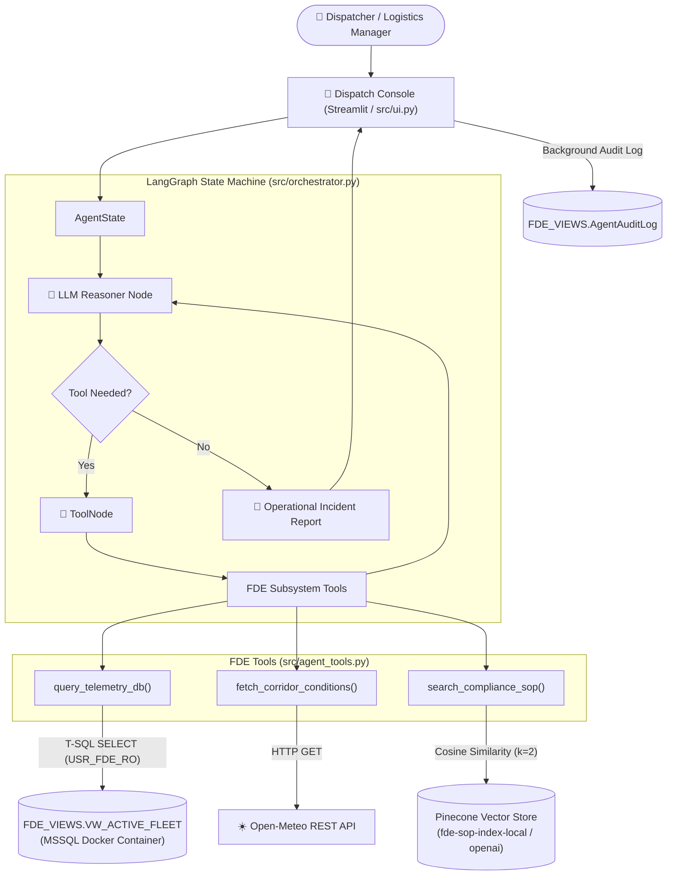

# 🧊 Cold-Chain Logistics FDE Operational Control Platform

[](https://www.python.org/)
[](https://www.langchain.com/langgraph)
[](https://www.microsoft.com/sql-server)
[](https://www.pinecone.io/)
[](https://streamlit.io/)

An enterprise-grade, AI-driven operational control system for refrigerated supply chain logistics, built with a **Forward Deployed Engineering (FDE)** mindset. 

This platform enables non-technical logistics dispatchers to ask natural language questions regarding fleet temperature breaches, traffic corridor disruptions, and regulatory compliance. Under the hood, an autonomous state-machine agent queries SQL telemetry, fetches live weather APIs, and searches vector-indexed Standard Operating Procedures (SOPs) to generate actionable incident resolution plans.

---

## 💡 Key Highlights & Architecture

* **Autonomous Multi-Source Investigation**: Uses a cyclic **LangGraph state machine** to autonomously orchestrate between SQL database telemetry, live weather REST APIs, and vector compliance search.
* **Least-Privilege Security & Semantic Layer**: Abstracts legacy database tables through a T-SQL semantic view (`FDE_VIEWS.VW_ACTIVE_FLEET`) and enforces read-only database permissions (`USR_FDE_RO`), eliminating SQL injection and schema hallucination risks.
* **Incremental RAG Pipeline**: Ingests enterprise SOPs (Markdown, PDF, CSV, XLSX) into Pinecone with MD5 hash caching to skip unchanged files, auto-purge deleted documents, and optimize vector upserts.
* **Hybrid Cloud & Air-Gapped AI execution**: Supports cloud runtimes (OpenAI `gpt-4o` / DeepSeek Cloud) and fully local air-gapped runtimes (Ollama `qwen2.5:7b` + CPU RAM cached `BAAI/bge-m3` embeddings).
* **Enterprise Audit Trail**: Tracks every tool call parameter, output payload, and LLM reasoning step in a write-only SQL audit log table (`FDE_VIEWS.AgentAuditLog`) accessible via a password-protected admin UI.

---

## 🏗️ System Architecture



---

## 📁 Repository Structure

```
.
├── PROJECT_DEEP_DIVE.md       # ⭐ Deep architectural guide & interview prep
├── data/
│   ├── cache/                 # MD5 ingestion hash cache (ingestion_hash_cache.json)
│   ├── policy/                # Enterprise SOP documents (Cold_Chain_Incident_SOP_v2.md)
│   ├── raw/                   # Raw historical telemetry CSV dataset
│   └── source/                # Source metadata
├── docs/
│   └── instrutions.md         # Deployment & step-by-step phase instructions
├── requirements.txt           # Python dependency locks
├── scripts/
│   ├── ingest_legacy_data.py  # Ingests raw CSV telemetry into Docker MSSQL
│   ├── ingest_sop_pinecone.py # Incremental polymorphic RAG parser & vector sync
│   └── setup_security_and_view.sql # T-SQL semantic view & security permissions
└── src/
    ├── agent_tools.py         # Subsystem tool definitions (SQL, API, Pinecone)
    ├── orchestrator.py        # LangGraph state machine & LLM factory
    ├── ui.py                  # Streamlit Dispatch Console & Audit Viewer
    └── prompts/
        └── system_prompt.txt  # System prompt & structured output format
```

---

## 🚀 Quick Start Guide

### 1. Prerequisites
* **Python**: 3.12+
* **Docker Desktop**: Installed and running
* **Pinecone API Key**: Free tier or enterprise key from [Pinecone](https://app.pinecone.io)
* **OpenAI / DeepSeek API Key** *(Optional - Local Ollama fallback supported)*

---

### 2. Environment Setup

Clone the repository and set up a virtual environment:

```bash
git clone https://github.com/imtushar01/cold-chain-logistics-FDE.git
cd cold-chain-logistics-FDE

python3 -m venv venv
source venv/bin/activate  # On Windows: venv\Scripts\activate
pip install -r requirements.txt
```

Create a `.env` file in the project root:

```env
# Database Settings
SQL_SERVER_HOST=localhost
SQL_SERVER_PORT=1433
SQL_ADMIN_USER=sa
SQL_ADMIN_PASSWORD=FdeEnterprisePass123!
SQL_AGENT_USER=USR_FDE_RO
SQL_AGENT_PASSWORD=AgentPassword2026!

# AI / Vector DB Settings
PINECONE_API_KEY=your_pinecone_api_key_here
Embeddings_model=LOCAL                   # Options: LOCAL | OPENAI
Local_Embedding_Model=BAAI/bge-m3       # Local HuggingFace embedding target
Agent_llm=DEEPSEEK                       # Options: OPENAI | DEEPSEEK | OLLAMA
DEEPSEEK_API_KEY=your_deepseek_api_key   # Required if Agent_llm=DEEPSEEK
OPENAI_API_KEY=your_openai_api_key       # Required if Agent_llm=OPENAI
```

---

### 3. Spin Up Legacy MSSQL Database

Run Microsoft SQL Server 2022 in Docker:

```bash
docker run -e "ACCEPT_EULA=Y" \
  -e "MSSQL_SA_PASSWORD=FdeEnterprisePass123!" \
  -p 1433:1433 \
  --name legacy-mssql \
  -d mcr.microsoft.com/mssql/server:2022-latest
```

Ingest historical fleet telemetry into the database:

```bash
python scripts/ingest_legacy_data.py
```

---

### 4. Setup Database Security & Semantic Layer

Execute the T-SQL script using VS Code SQL Extension, Azure Data Studio, or `sqlcmd`:

```bash
# Creates schema FDE_VIEWS, semantic view VW_ACTIVE_FLEET, and read-only login USR_FDE_RO
# Run scripts/setup_security_and_view.sql on your database
```

Create the audit trail log table in MSSQL:

```sql
CREATE TABLE FDE_VIEWS.AgentAuditLog (
    LogID INT IDENTITY(1,1) PRIMARY KEY,
    Timestamp DATETIME DEFAULT GETDATE(),
    SessionID VARCHAR(50),
    NodeExecuted VARCHAR(50),
    ToolName VARCHAR(100),
    Content NVARCHAR(MAX)
);

GRANT INSERT ON FDE_VIEWS.AgentAuditLog TO USR_FDE_RO;
```

---

### 5. Ingest SOP Documents into Pinecone

Run the incremental RAG ingestion pipeline:

```bash
python scripts/ingest_sop_pinecone.py
```

---

### 6. Launch the Control Console

Start the Streamlit Web Application:

```bash
streamlit run src/ui.py
```

Navigate to `http://localhost:8501` in your browser.

---

## 🧪 Sample Verification Queries

Try entering these dispatcher queries into the console:

1. **The Domino Effect Anomaly Query** *(Triggers SQL Telemetry + Live Corridor API + Pinecone SOP Search)*:
   > *"Find any active shipments near Los Angeles (Latitude ~33.8, Longitude ~-118.1). Check the local weather there, and tell me if the current cargo temperature violates the SOP for fresh perishables."*

2. **No-Tool SOP Knowledge Query** *(Triggers Pinecone Vector Search)*:
   > *"I'm a new dispatcher on the night shift. Can you quickly explain the difference between a Tier 1 and Tier 2 escalation?"*

---

## 📖 Deep Dive & Interview Preparation

For a comprehensive technical walkthrough, failure mode analysis, code traces, and senior interview preparation guide, view the full documentation:

👉 **[PROJECT_DEEP_DIVE.md](PROJECT_DEEP_DIVE.md)**

---

## 📄 License

Distributed under the MIT License. See `LICENSE` for more information.
